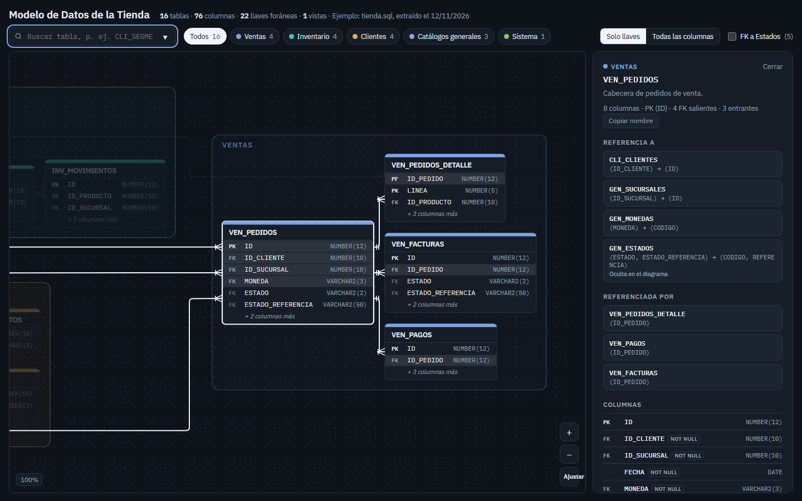

# er-diagram-skill

Un skill para agentes de IA (Claude Code, Codex, Gemini CLI, Cursor o cualquiera que ejecute comandos) que genera un **diagrama entidad-relación interactivo** a partir del esquema real de tu base de datos. El resultado es **un solo archivo HTML** que se abre con doble clic.



## Qué hace

1. **Extrae el esquema** de una de tres fuentes:
   - el diccionario de **Oracle**, solo con `SELECT` vía `sqlplus`;
   - un **script DDL** de Oracle, SQL Server, PostgreSQL o MySQL;
   - un modelo **EF Core**, a través de `dotnet ef dbcontext script`.
2. **Te muestra las tablas encontradas** agrupadas por prefijo, para que elijas cuáles diagramar o las filtres con patrones tipo `LIKE` (`%VEN%`, `INV_%`, excluir `%_LOG`…).
3. **Las agrupa por módulos** y oculta por defecto las FK a catálogos transversales (estados, monedas…), que son las que vuelven ilegible cualquier diagrama grande.
4. **Genera el HTML**, que trae:
   - búsqueda y filtro por módulo;
   - vista "solo llaves / todas las columnas";
   - zoom y arrastre;
   - líneas pata de gallo;
   - un panel con comentarios, columnas, FK salientes y entrantes;
   - tema claro y oscuro, y vista para teléfono.
5. **Verifica el layout** (que no haya tablas encimadas ni líneas mal ancladas) y, si tienes Playwright, toma capturas.

## Instalación

```bash
git clone https://github.com/D11110/er-diagram-skill.git
cd er-diagram-skill/scripts && npm install     # única dependencia: elkjs 0.9.3
```

Requiere **Node 18 o superior**. Para extraer de Oracle en vivo también necesitas `sqlplus` en el PATH (Oracle Client o Instant Client).

### Como skill de Claude Code

Clona el repo dentro de tu carpeta de skills:

```bash
git clone https://github.com/D11110/er-diagram-skill.git ~/.claude/skills/er-diagram-skill
cd ~/.claude/skills/er-diagram-skill/scripts && npm install
```

Después basta con pedir algo como *"hazme un diagrama ER de las tablas de ventas"*.

### Con otros agentes

`SKILL.md` es markdown plano con los pasos y comandos exactos. Dáselo como instrucciones a tu agente, o apúntalo a la carpeta. Los scripts no dependen de ninguna herramienta propia de un proveedor.

## Uso rápido sin base de datos

```bash
cd scripts
node from-ddl.js --in ../examples/tienda.sql --source "Ejemplo" --out /tmp/full.json
node select-tables.js --schema /tmp/full.json --list
node select-tables.js --schema /tmp/full.json --like "VEN_%,INV_%" --with-parents --out /tmp/schema.json
node init-config.js --schema /tmp/schema.json --title "Modelo de Datos de la Tienda" --out /tmp/config.json
node build.js --schema /tmp/schema.json --config ../examples/tienda.config.json --out /tmp/tienda.html --inline-elk
node verify.js --schema /tmp/schema.json --config ../examples/tienda.config.json
```

Abre `/tmp/tienda.html` en el navegador.

## Oracle en vivo

```bash
export ORA_CONN='usuario/clave@//host:1521/servicio'
node extract-oracle.js --conn-env ORA_CONN [--owner ESQUEMA] --out schema-full.json
# o tomando la cadena de un appsettings.json de .NET:
node extract-oracle.js --appsettings ../MiApp/appsettings.json --key DefaultConnection --out schema-full.json
```

- **Solo lectura**: el script ejecuta únicamente `SELECT` sobre las vistas del diccionario (`USER_*`, o `ALL_*` con `--owner`).
- **La contraseña no queda expuesta**: viaja a `sqlplus` por stdin y se tacha en los mensajes de error.
- **Sin secretos en el HTML**: solo contiene nombres, tipos y comentarios.

## Selección de tablas

| Opción | Efecto |
|---|---|
| `--list [--list-file t.txt]` | Inventario: totales, grupos por prefijo y lista completa |
| `--like "VEN_%"` | Incluye las que coinciden (repetible o separado por comas) |
| `--not-like "%_LOG"` | Excluye |
| `--tables A,B` / `--tables-file t.txt` | Nombres exactos (puedes editar la lista de `--list-file`) |
| `--with-parents` | Agrega las tablas padre de las FK de la selección, un nivel |

En los patrones, `%` es comodín y `_` es **literal**, así que `VEN_%` significa "empieza con VEN_". No se distinguen mayúsculas de minúsculas.

## Estructura

```
SKILL.md                 instrucciones para el agente
scripts/                 extract-oracle, from-ddl, select-tables, init-config, build, verify
scripts/lib/             núcleo del layout (compartido node/navegador), config y utilidades
assets/template.html     la página interactiva
references/              formato de schema.json/config y guía EF Core/DDL
examples/                esquema de ejemplo (tienda) y su configuración
```

## Licencia

[MIT](LICENSE)
